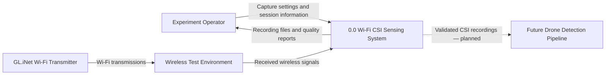
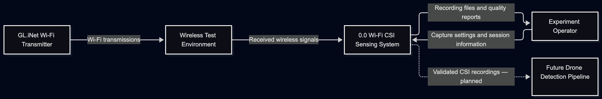
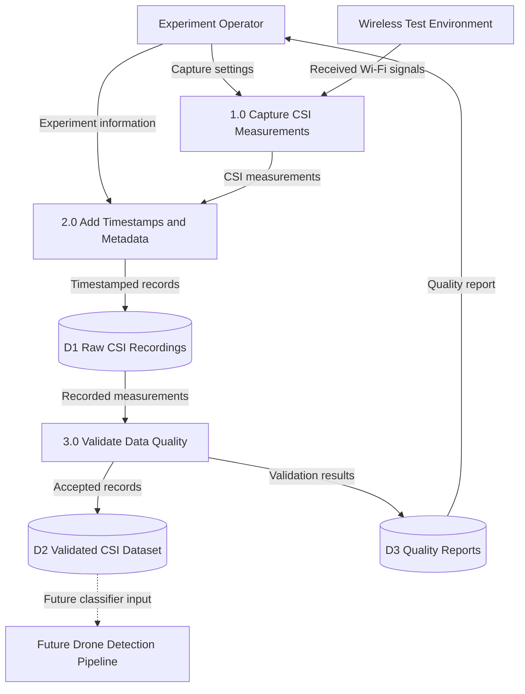
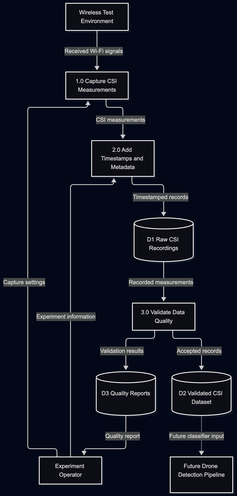

# Titan Security — CSI Data Flow Design

**Project:** Radar over WiFi  
**Group:** G19 — Titan Security  
**Owner:** 23jdo5  
**Epic:** #2 — Wi-Fi CSI Sensing  
**Related User Stories:** #8, #13  
**Task:** #47 — Create CSI Data Flow Diagram  
**Sprint:** Sprint 2  
**Status:** Proposed Design  
**Specification:** [Wi-Fi CSI Sensing Specification — PR #46](https://github.com/sopper75/CPSC490-G19-TitanSecurity/pull/46)

## 1. Overview

This document describes the planned data flow for Titan Security's Wi-Fi CSI sensing system.

The system aims to capture wireless channel measurements, associate them with timestamps, store the recordings, and validate their quality before using them for drone detection.

The diagrams represent the proposed system design. Full CSI acquisition and drone detection have not yet been demonstrated.

## 2. Level 0 — CSI Data Flow Diagram

The Level 0 diagram illustrates how the Wi-Fi CSI sensing system interacts with external components.

**Figure 1 — Level 0 CSI Data Flow Diagram.**

Figure 1 shows the external inputs and outputs of the planned Wi-Fi CSI sensing system. Wireless transmissions pass through the experimental environment, where physical objects and interference may affect the channel. The sensing system will capture measurements, record experimental information, and produce quality reports. Validated recordings will later support the drone detection pipeline.

Dashed arrows represent future integrations.

## 3. Level 1 — CSI Data Flow Diagram

Figure 2 expands the Wi-Fi CSI sensing system from Figure 1 into three proposed processes: measurement capture, timestamping and recording, and data-quality validation.

**Figure 2 — Level 1 CSI Data Flow Diagram.**

Figure 2 shows the proposed internal data flow of the CSI sensing system. Measurements will be captured through compatible receiver hardware, associated with timestamps and experiment information, and stored in raw recording files. The data-quality process will then produce validated records and quality reports.

All numbered processes and data stores represent planned functionality. The final CSI-compatible receiver and capture method are still to be confirmed.
