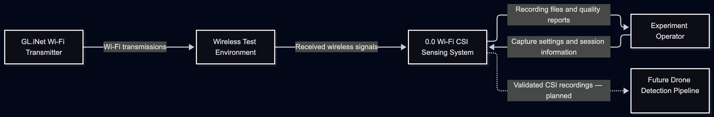
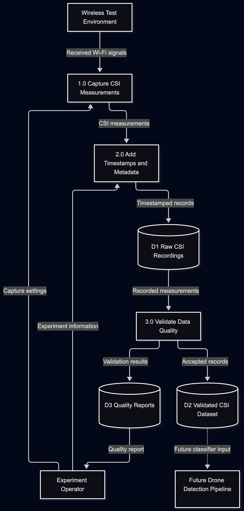

# Project Proposal — Radar over WiFi

**Department of Computer Science**

**CPSC 490 Undergraduate Seminar in Computer Science — Proposal for Capstone Project**

**Group G19 — Titan Security** · Sponsor: RTX-2  
Authors: Do, Jonathan (23jdo5), Cao, Delvin (@sopper75), Headley, Zachary (Zwach), Le, Alex (dappurs), Sisavath, Chase (Badtzi)  
Repository: https://github.com/sopper75/CPSC490-G19-TitanSecurity  
Semester: Fall 2026  
Original proposal date: October 4, 2026  
Draft revision date: October 8, 2026  

**Draft status:** Sections 0–2 combine the team's supplied project description with revised wording and proposed objectives. Section 4 now includes the planned Wi-Fi CSI data-flow diagrams and associated design-document references. Sections 3 and 5–7, along with the remaining environment and architecture details in Section 4, still require team completion. The team must review the draft, resolve **TO CONFIRM** fields, add actual issue links, and verify references before submission.

## 0. Abstract

In the present day, cheap and inexpensive drones are widely accessible to the average consumer, increasingly being used to disrupt critical infrastructure, or even pose a potential threat to the public. Early detection of these drones is a critical need as the time between detection and impact can determine how well protected people are from potential drone attacks.  

The problem lies within Radar being the obvious solution, but it has a high cost to implement, especially in the case of detecting relatively small objects such as drones which have small radar signatures.  

Our proposal for a solution involves Wi-Fi. Wi-Fi infrastructure is already widespread within homes, campuses, and venues. Using Wi-Fi signals, one can potentially passively detect drones which create a disturbance in the radio waves being emitted. This disturbance can be picked up by analyzing the Channel State Information [1], allowing detection and even estimation of position and movement without the need to implement or install expensive Radar equipment [2].  

This solution is significant, because it potentially resolves a problem using inexpensive yet effective infrastructure. Wi-Fi signals are low energy, short range, yet highly sensitive to reflectance, interference, and background noise, which allows for detection in the first place.  

The goal of this project is to build a prototype which is effective at detecting small drones or signatures representing drones through Wi-Fi signal waves, with evaluations to it’s accuracy, effective range, and rate of false detections. The expected outcome is an assessment of how useful Wi-Fi sensing at an effective cost could provide useful information far ahead of time to those who need it. The reset of the proposal details our methodology, system design, and evaluation plan. 

## 1. Introduction

Radar detects objects by transmitting radio waves and analyzing reflected signals. Wi-Fi also uses radio waves, primarily to exchange data between devices. Signals can reach a receiver along multiple paths after reflecting from surrounding objects. Movement can change these paths and the measured wireless channel. CSI provides measurements that researchers can use to investigate these changes [1].  

Radar over WiFi will examine whether accessible Wi-Fi equipment can provide useful information about nearby drone activity. A central challenge is distinguishing drone-related changes from changes caused by people, interference, or ordinary background variation. Detecting motion alone would not satisfy the project's drone-detection objective.  

The project is motivated by affordability, portability, and setup effort. These benefits will be evaluated rather than assumed. The initial scope is a controlled experimental prototype; results will describe the equipment, environments, and conditions actually tested. They will not establish suitability for operational security or field deployment.  

### 1.1 Related Work

Halperin et al. describe a tool for collecting CSI, providing a foundation for experimental wireless-channel measurements [1]. Geng's thesis and the related DensePose From WiFi paper investigate estimating human pose from Wi-Fi measurements [2], [3]. These works motivate the use of wireless measurements for sensing, but their human-sensing results do not establish drone-detection performance.  

The team's supplied literature review also identifies BFId, which investigates identity inference using Wi-Fi beamforming feedback [4]. Its relevance is that wireless measurements may reveal information beyond their original communication purpose. It addresses a different measurement source and task from the proposed drone classifier. The ESP-CSI project provides a practical example of human-presence sensing with ESP32 equipment [5]. As a project account, it offers implementation context rather than direct evidence of performance for this project's target.  

| Existing approach | Contribution relevant to this project | Strength | Limitation for our project | How Radar over WiFi differs |
|---|---|---|---|---|
| CSI collection tool [1] | Collection of wireless-channel measurements | Provides a basis for reproducible measurement work | Collection alone does not identify drones; equipment compatibility must be checked | Adds labeled drone experiments and detection evaluation |
| Human-pose estimation [2], [3] | Learning relationships between Wi-Fi measurements and physical activity | Investigates richer outputs than presence alone | Human-pose results do not demonstrate drone sensing or transfer to our equipment | Evaluates drone presence and investigates position and movement |
| BFId [4] | Identity inference from beamforming feedback | Highlights information exposed by wireless measurements | Uses a different task and measurement approach | Focuses on drone-versus-non-drone conditions |
| ESP-CSI presence project [5] | Practical sensing with accessible hardware | Offers prototype and deployment context | Human-presence results are not drone-detection results | Measures drone detection, confounding conditions, and range |

These approaches differ in their measurements, targets, and outputs. The proposed contribution is not that Wi-Fi sensing is new, but that the team will evaluate a specific accessible setup for drone sensing and document its practical limitations. Hardware selection and testing must establish which lessons transfer to this project.

**TO CONFIRM:** Team members must verify the comparison against the sources they have read. Select and cite the conventional radar systems used for the later cost and deployment comparison; none have been identified yet.

### 1.2 Problem Statements

**P1. Reproducible measurements:** The project needs a repeatable way to obtain and preserve usable wireless-channel measurements so experiments can be compared and checked.

**P2. Target discrimination and estimation:** Changes in wireless measurements are not unique to drones. It remains uncertain whether the selected equipment can distinguish drone activity from human movement and interference and support useful estimates of position and movement.

**P3. Performance and practicality:** The detection range, error rates, cost, portability, and setup effort of the proposed system have not been established. Without these measurements, its usefulness and trade-offs relative to conventional radar cannot be assessed.

| Problem | Addressed by |
|---|---|
| P1 | Goal 1; Objectives 1.1–1.2 |
| P2 | Goal 2; Objectives 2.1–2.3 |
| P3 | Goal 3; Objectives 3.1–3.3 |

## 2. Goals and Objectives

### Goal 1: Build a Wi-Fi CSI sensing platform

**[[epic:#2]](https://github.com/sopper75/CPSC490-G19-TitanSecurity/issues/2).**

**Objective 1.1: Set up a Wi-Fi transmitter and receiver pair and demonstrate CSI frame capture.**  
Document the equipment and configuration needed to reproduce the setup, and verify that the receiver captures CSI frames during a test recording. **[[story:#8]](https://github.com/sopper75/CPSC490-G19-TitanSecurity/issues/8).**

**Objective 1.2: Save CSI measurements to timestamped files and verify their data quality.**  
Implement a recording process and check the saved measurements for missing or malformed records and timestamp consistency. Document the checks and their results. **[[story:#13]](https://github.com/sopper75/CPSC490-G19-TitanSecurity/issues/13).**

### Goal 2: Detect drones and estimate their position and movement using Wi-Fi CSI

**[[epic:#3]](https://github.com/sopper75/CPSC490-G19-TitanSecurity/issues/3).**

**Objective 2.1: Collect labeled CSI datasets for drone activity, empty background, human movement, and interference conditions.**  
Record the condition and equipment arrangement for each recording. Document the amount of data collected for each condition and separate training and evaluation recordings. **[[story:#14]](https://github.com/sopper75/CPSC490-G19-TitanSecurity/issues/14).**

**Objective 2.2: Train and evaluate a classifier that distinguishes drone presence from non-drone conditions.**  
Use the labeled datasets to develop the classifier and evaluate it on recordings excluded from training. Report its predictions for drone activity, empty background, human movement, and interference conditions. **[[story:#15]](https://github.com/sopper75/CPSC490-G19-TitanSecurity/issues/15).**

**Objective 2.3: Implement and evaluate estimates of drone position and movement in a controlled test area.**  
Compare the estimates with recorded reference positions and movements. Report position error and how consistently the system identifies movement, including conditions where estimation fails. **[[story:#7]](https://github.com/sopper75/CPSC490-G19-TitanSecurity/issues/7).**

### Goal 3: Evaluate detection performance and practical trade-offs against conventional radar

**[[epic:#4]](https://github.com/sopper75/CPSC490-G19-TitanSecurity/issues/4).**

**Objective 3.1: Measure drone-detection accuracy, missed detections, and false detections on held-out test recordings.**  
Report the evaluation results and define how each metric is calculated. Present results separately for the tested conditions so that the effects of human movement and interference are visible. **[[story:#6]](https://github.com/sopper75/CPSC490-G19-TitanSecurity/issues/6).**

**Objective 3.2: Measure drone-detection performance at multiple distances to determine the effective detection range.**  
Define the distance reference, test arrangement, and criterion for successful detection before conducting the evaluation. Repeat trials at each tested distance and report the farthest tested distance that meets the criterion under those conditions. **[[story:#16]](https://github.com/sopper75/CPSC490-G19-TitanSecurity/issues/16).**

**Objective 3.3: Compare prototype cost, portability, and setup effort with selected conventional radar systems using documented evidence.**  
Record the prototype's equipment cost, physical size, weight, and setup time. Compare these measurements with available published information for the selected radar systems, identifying unavailable data and differences in capabilities or testing conditions. **[[story:#17]](https://github.com/sopper75/CPSC490-G19-TitanSecurity/issues/17).**

The proposed radar comparison is literature-based rather than a commitment to obtain radar equipment. The team must confirm this scope. Performance thresholds, trial counts, and test distances will be specified before final evaluation. Surrogate targets, if used during development, will be identified separately and will not be presented as evidence of actual drone detection.

### Goal 4: Maintain clear team organization and documentation [[epic: #55]](https://github.com/sopper75/CPSC490-G19-TitanSecurity/issues/55)

**Objective 4.1: Define and document team roles and leadership designation.**  
Record each team member's role and the designated team leader in the project README. **[[story:#56]](https://github.com/sopper75/CPSC490-G19-TitanSecurity/issues/56).**

**Objective 4.2: Define different approaches considered and choosen approach.**
Define the approaches considered for achieving the stated goals, listing possible strategies and reasoning that decided between them. **[[story:#67]](https://github.com/sopper75/CPSC490-G19-TitanSecurity/issues/67).**

**Objective 4.3: Complete Sprint 2 Review.**  
Complete the Sprint 2 review in `docs/sprint-reviews/sprint-2.md`, recording progress, velocity, carry-overs, and member contributions for Sprint 2. **[[story:#69]](https://github.com/sopper75/CPSC490-G19-TitanSecurity/issues/69).**

## 3. Proposed Approaches

Our approach consists of mounting Wifi antennas to tripods, connected to a mini microcontroller detecting CSI packets, and sending the packets received to two computers. These two computers jobs are to filter the packets for any traffic that is not needed. The computers will then send the filtered packets to a main processing computer, which then processes the CSI packets to detect for drone movement & detection.

We considered two alternatives. One was to have only computer filter the CSI packets to be sent for processing. This streamlines the process, and makes the test setup easier to configure. But this creates a single bottleneck, meaning if the packet rate increases, or all the antennas start sending traffic, could slow down the filtering or worse, shut down the pipeline if the computer is overwhelmed. Another was to use standard Wifi adapters to intercept traffic instead of the microcontrollers. These are more familar and more widely available, but usually it's signifcantly harder to capture CSI packets without specailized hardware, making it harder to configure the setup.

We chose two filtering computers feeding one processing computer, using the microcontroller modules, because this keeps each stage's workload manageable and gives us direct access to CSI. Exact implementation is described in §4.

## 4. Required Environment, Resources, and Planned Activities

> Review the required and available resources and environment to complete your project. For example, server, platform, software tools, operating systems, DBMS, or any required skills.
>
> Describe the expected activities to achieve the stated goals, e.g., software development process.

〈The team must complete the remaining environment, resources, and planned activities description, including the proposed hardware and software stack and how each component will be used.〉

**Design diagrams:** This section includes the Wi-Fi CSI sensing data-flow diagrams. The team must also supply a high-level architecture diagram and a system/context diagram, along with other appropriate design views, and keep authoritative copies in `docs/design/`.

### Wi-Fi CSI Sensing — Data Flow Design

The proposed Wi-Fi sensing system will collect wireless channel measurements and prepare them for later drone-detection analysis. The data-flow design supports Objective 1.1 (CSI acquisition, issue #8) and Objective 1.2 (timestamped recording and data quality, issue #13).

Figure 1 illustrates the external components involved in the sensing process. The GL.iNet Wi-Fi transmitter sends signals through the experimental environment, where moving objects and interference may affect the wireless channel. A compatible receiver and sensing system will collect measurements and provide recordings and quality reports to the experiment operator. The planned drone detection pipeline will later consume validated CSI data.

**Figure 1 — Level 0 Wi-Fi CSI Data Flow Diagram.**

Figure 2 expands the sensing system into three proposed processes: capturing CSI measurements, adding timestamps and experimental metadata, and validating recorded data. The design separates raw recordings, validated datasets, and quality reports to support reproducible experiments.

**Figure 2 — Level 1 Wi-Fi CSI Data Flow Diagram.**

Both diagrams describe the planned design rather than completed functionality. Full CSI capture and automated validation have not yet been demonstrated, and the final compatible receiver and acquisition method remain to be confirmed.

The editable Mermaid diagrams, detailed descriptions, and data-flow documentation are maintained in [CSI Data Flow Design](../docs/design/csi-data-flow.md), tracked under [issue #47](https://github.com/sopper75/CPSC490-G19-TitanSecurity/issues/47).

### Specification and design documents

**Every specification and design document the team writes must be listed here** with the objective it serves. This section acts as the index of the project's technical detail. CI gate G9 checks for links to these documents.

| Document                                                             | Kind          | Covers                                                                                                | Issues                                                                      |
| -------------------------------------------------------------------- | ------------- | ----------------------------------------------------------------------------------------------------- | --------------------------------------------------------------------------- |
| [Wi-Fi CSI Sensing Specification](../docs/specs/wifi-csi-sensing.md) | specification | Hardware configuration, CSI acquisition, timestamped recording, data quality, and acceptance criteria | [task:#45](https://github.com/sopper75/CPSC490-G19-TitanSecurity/issues/45) |
| [CSI Data Flow Design](../docs/design/csi-data-flow.md)              | design        | Level 0 and Level 1 CSI data flow; Objectives 1.1–1.2                                                 | [task:#47](https://github.com/sopper75/CPSC490-G19-TitanSecurity/issues/47) |
| [Drone Detection Specification](../docs/specs/drone-detection.md) | specification | Drone detection requirements and acceptance criteria | [task:#49](https://github.com/sopper75/CPSC490-G19-TitanSecurity/issues/49) |
| [Evaluation Specification](../docs/specs/evaluation.md) | specification | Detection performance and evaluation requirements | [task:#50](https://github.com/sopper75/CPSC490-G19-TitanSecurity/issues/50) |

| Document | Kind | Covers | Issues |
|---|---|---|---|
| 〈docs/specs/account-management.md〉 | specification | 〈account management requirements〉 | 〈#n, #n〉 |
| 〈docs/design/architecture.md〉 | design | 〈system architecture + data model〉 | 〈#n〉 |

The CSI Data Flow Design documents the proposed sensing subsystem through Level 0 and Level 1 diagrams. It identifies external inputs, measurement capture, timestamping, raw recording storage, validation, and the intended downstream detection pipeline. Its editable Mermaid source and exported images are maintained in `docs/design/`.

The specification was merged through [PR #46](https://github.com/sopper75/CPSC490-G19-TitanSecurity/pull/46). The design document was developed under [issue #47](https://github.com/sopper75/CPSC490-G19-TitanSecurity/issues/47).

**Remaining documentation:** The team must add other specifications and design documents to this index as they are completed. The repository's worked examples, `docs/specs/example-spec.md` and `docs/design/example-design.md`, should be handled according to the course repository instructions.

### Planned activities — the work items

The goals and objectives are listed in §2 as epics and user stories. The following table links supporting work items.

| Issue | Type | Activity | Parent | Owner | Sprint |
|---|---|---|---|---|---|
| [[task:#11]](https://github.com/sopper75/CPSC490-G19-TitanSecurity/issues/11) | task | Update proposal sections 0–2 | Standalone | 23jdo5 | Sprint 1 |
| [[task:#20]](https://github.com/sopper75/CPSC490-G19-TitanSecurity/issues/20) | task | Clean up proposal header and §2 issue links | Standalone | sopper75 | Sprint 1 |
| [[task:#23]](https://github.com/sopper75/CPSC490-G19-TitanSecurity/issues/23) | task | Update course files to CPSC 490 c155339 | Standalone | sopper75 | Sprint 1 |
| [[task:#26]](https://github.com/sopper75/CPSC490-G19-TitanSecurity/issues/26) | task | Revise §0–§1 from HW#4 feedback | Standalone | sopper75 | Sprint 1 |
| [[task:#27]](https://github.com/sopper75/CPSC490-G19-TitanSecurity/issues/27) | task | Write §1.1 Related Work (comparative table) | Standalone | Zwach | Sprint 1 |
| [[task:#28]](https://github.com/sopper75/CPSC490-G19-TitanSecurity/issues/28) | task | Write §1.2 Problem Statements P1..Pn | Standalone | Zwach | Sprint 1 |
| [[task:#29]](https://github.com/sopper75/CPSC490-G19-TitanSecurity/issues/29) | task | Write §2 Goals and Objectives | Standalone | 23jdo5 | Sprint 1 |
| [[task:#34]](https://github.com/sopper75/CPSC490-G19-TitanSecurity/issues/34) | task | Add #23 and #26-#29 to §4 | Standalone | dappurs | Sprint 1 |

## 5. Project Outcomes

> Describe the outcomes or deliverables, e.g., final project report, user manuals, source code, data or database files, etc.
>
> Note: the deliverables always include the team GitHub repository, which must already contain prototype v0 (a thin end-to-end proof-of-concept, however small, running when this proposal is submitted). Briefly describe what your v0 demonstrates and how to run it.

〈**One or two paragraphs** explaining the project outcome overall — what will exist when the project is finished, and what it will let someone do. Keep it prose, not a checklist; name the deliverables inside the paragraphs, and say briefly what prototype v0 demonstrates today and how to run it.〉

## 6. Project Timeline

> Identifies tasks (project objectives) to be performed, milestones to be met, and the estimated number of hours for each task.

〈**This is the plan for CPSC 491 next semester** — the implementation timeline, not this semester's proposal work. Identify the tasks (your objectives from §2), the milestones, and the estimated hours for each task, in the order they will be built. State the assumptions it rests on (sponsor availability, data access, hardware).〉

| Task (objective) | Milestone | Owner | Est. hours | Spring phase |
|---|---|---|---|---|
| 〈…〉 | 〈…〉 | 〈…〉 | 〈…〉 | 〈…〉 |
| 〈…〉 | 〈…〉 | 〈…〉 | 〈…〉 | 〈…〉 |

〈Do **not** put this fall's four proposal sprints here — those live on the project board and in `docs/sprint-reviews/`. This section answers "how does the system actually get built next semester?"〉

## 7. AI Usage

> Per the course AI policy (see the syllabus, Use of AI Tools), disclose the AI tools used in preparing this proposal and the prototype: which tools, for what tasks (e.g., code generation, test writing, debugging, diagramming), and approximately what fraction of each artifact was AI-assisted.
>
> Reminder: the prose of this proposal must be your own writing. You remain fully responsible for the correctness of all AI-assisted work, including the prototype code.

〈Your disclosure. Naming the tool is not disclosure — name what it drafted, what fraction of each artifact was AI-assisted, and how you verified it.〉

## 8. References

The following references are retained from the team's supplied draft. Their bibliographic details and support for the statements above require team verification; inclusion here does not certify that they have been independently checked.

[1] Halperin, D., Hu, W., Sheth, A., and Wetherall, D. “Tool Release: Gathering 802.11n Traces with Channel State Information.” *ACM SIGCOMM Computer Communication Review*, 41(1), p. 53, 2011. https://doi.org/10.1145/1925861.1925870

[2] Geng, J. *Dense Human Pose Estimation From WiFi*. Master's thesis, Carnegie Mellon University, Technical Report CMU-RI-TR-22-59, 2022. https://publications.ri.cmu.edu/dense-human-pose-estimation-from-wifi

[3] Geng, J., Huang, D., and De la Torre, F. *DensePose From WiFi*. arXiv:2301.00250. https://arxiv.org/abs/2301.00250. **TO CONFIRM: publication year; the supplied draft lists 2022.**

[4] Todt, J., Morsbach, F., and Strufe, T. “BFId: Identity Inference Attacks Utilizing Beamforming Feedback Information.” *Proceedings of the 2025 ACM SIGSAC Conference on Computer and Communications Security*, pp. 2399–2413, 2025. https://doi.org/10.1145/3719027.3765062

[5] Mengdu. “ESP-CSI: DIY WiFi Human Presence Detection.” *Hackster.io*, January 15, 2026. https://www.hackster.io/limengdu0117/esp-csi-diy-wifi-human-presence-detection-f80508. Accessed October 4, 2026, as recorded in the team's draft.
